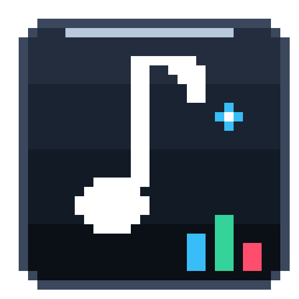

<div align="center">



# Skyler's Miniplayer

**A frameless, always-on-top desktop miniplayer for Windows** — retro-pixel and ambient-glass themes,
synced karaoke lyrics, and a low-overhead native SMTC bridge that reads whatever Windows is playing.

[](LICENSE)


</div>

---

## Highlights

- **Native SMTC bridge** — reads the current track (title, artist, album, duration, timeline, cover art) straight from the
  Windows System Media Transport Controls API, so it works with *any* media app: Apple Music, Spotify, browsers, foobar2000, VLC.
  No account, no login, no per-app integration.
- **Six hand-tuned themes** — Ambient Glass (album-tinted glass, default), GameBoy, Pastel Pop, Cyber Lo-Fi, Win95 Retro, OLED Emerald.
- **Synced karaoke lyrics** — LRC line-by-line highlighting, a three-dots marker on instrumental sections, and click any line to seek.
  Sources are tried in order: local `.lrc` files, LRCLIB, QQ Music, then Musixmatch (optional user token).
  A total search budget keeps a lyrics-less track from hanging the UI.
- **Album art as ambient light** — a 4-tone palette is extracted from the cover and drives a liquid mesh gradient behind the UI.
- **8-bit dither shader & CRT overlay** — one toggle turns the cover into palette-quantized pixel art, another adds scanlines.
- **Animated beat mascot** — a pixel cat that bobs to the music and dozes off when paused.
- **Playback history** — the last 40 tracks with lightweight 64 px cover thumbnails.
- **Pinnable & draggable** — frameless window, drag anywhere, pin above games or editors. Position, size and pin state
  persist across restarts.
- **Offline-ready UI** — every font is bundled locally (no Google Fonts, no CDN); the renderer runs under a strict CSP
  with `connect-src 'none'` because all data arrives over IPC.
- **Single instance** — opening the app again just focuses the window that is already running.

---

## Requirements

- Windows 10 or Windows 11 (x64)
- Node.js 18+ (development only)

---

## Getting started

```bash
npm install
npm start
```

### Scripts

| Script | What it does |
| --- | --- |
| `npm start` | Run the app |
| `npm run check` | Syntax-check `main.js`, `preload.js`, `lyrics_manager.js`, `src/renderer.js` |
| `npm run build` | Build the Windows NSIS installer into `dist/` |

---

## Keyboard shortcuts

- `Space` — play / pause
- `Ctrl + Right Arrow` — next track
- `Ctrl + Left Arrow` — previous track
- `T` — cycle through themes
- `M` — open / close the theme popup menu
- `[` / `]` — nudge the lyric timing offset (-0.1 s / +0.1 s)
- `Esc` — close the open popup or dialog

---

## Custom lyrics

Drop `.lrc` files into the `lyrics/` folder next to the executable (see `lyrics/README.txt`). A local match always wins
over any online source. Supported file names: `Title.lrc`, `Artist - Title.lrc`, `Title - Artist.lrc`.

---

## Project structure

```
main.js            Electron main process, window state, IPC bridge
preload.js         Context-isolated API exposed to the renderer
lyrics_manager.js  Multi-source lyrics providers (local / LRCLIB / QQ Music / Musixmatch)
smtc_bridge.ps1    PowerShell SMTC polling bridge (stdout -> main process)
src/index.html     UI markup
src/style.css      Themes, pixel typography, CRT / mesh effects
src/renderer.js    Canvas shader, lyric engine, timeline interpolation
src/fonts.css      @font-face declarations for the bundled fonts
src/fonts/         Bundled font files (offline)
build/             App icon (build/icon.ico, icon.png) and its generator, build/make-icon.py
docs/              Performance audit and engineering notes
lyrics/            Drop your own .lrc files here
```

---

## Performance notes

The app started as a heavier prototype; the current revision cuts the bridge IPC payload by ~99.9 %,
shrinks stored playback history by ~99 %, and removes network dependencies from the UI.
Measurements, method and the full change log live in [`docs/PERFORMANCE-AUDIT.md`](docs/PERFORMANCE-AUDIT.md).

---

## Disclaimer

This is an independent open-source project. It is **not affiliated with, endorsed by, or sponsored by Apple Inc.**,
and it ships no Apple code, assets or trademark. "Apple Music" and other product names are trademarks of their
respective owners and are used here only to describe interoperability (the app reads any Windows media session
through the public SMTC API). All artwork rendered in the UI comes from your own local media sessions.

---

## License

[MIT](LICENSE) © 2026 Dirya Ramadhan (skilerrr)
